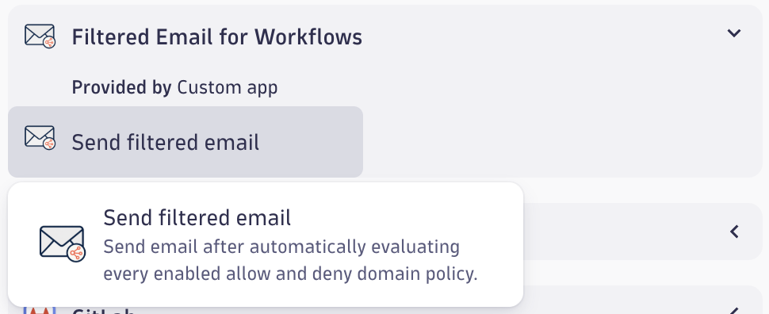
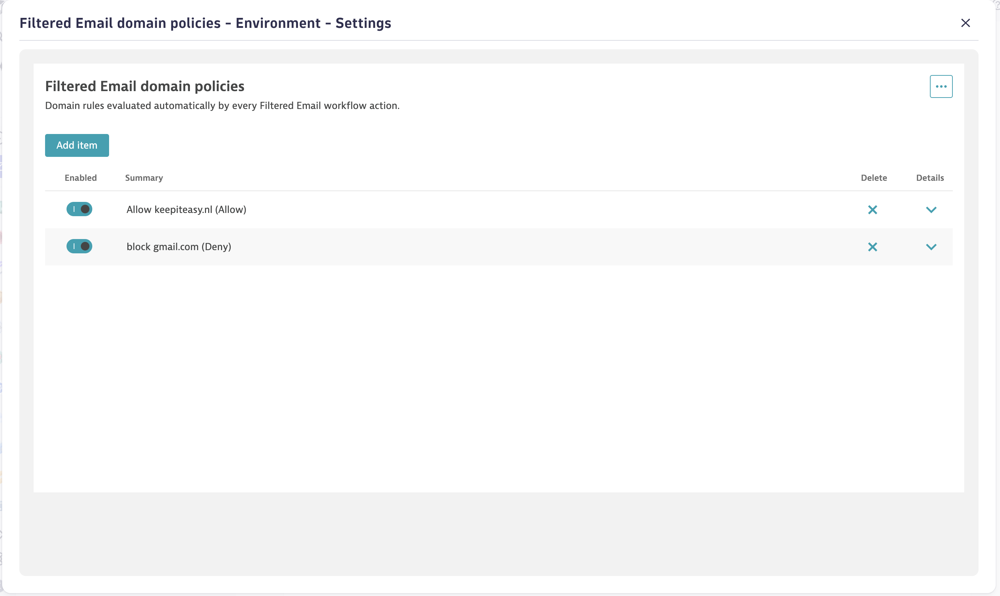

# Dynatrace Filtered Email for Workflows

Send email from Dynatrace Workflows while controlling which recipient domains are allowed.

> **Current version:** `1.0.0`
>
> **Status:** First stable release; independent non-production tenant validation is still recommended.

**Filtered Email for Workflows** evaluates every resolved recipient against centrally managed allow and deny domain policies before submitting an email to the Dynatrace Email service.

## Highlights

- Supports `To`, `Cc`, and `Bcc` recipients.
- Evaluates all enabled domain policies automatically.
- Supports allow and deny rules, exact domains, and optional subdomain matching.
- Gives deny rules precedence over allow rules.
- Removes blocked recipients and sends to the remaining permitted recipients.
- Fails without sending when every recipient is blocked.
- Reports blocked recipients in the action result.
- Supports workflow expressions and formatted Markdown email content.
- Masks recipient local parts in validation errors and action logs.

## How it works

1. Configure rules in **Filtered Email domain policies**.
2. Add **Send filtered email** to a Dynatrace workflow.
3. Configure recipients, subject, and message.
4. The action resolves workflow expressions and validates the recipients.
5. All enabled allow and deny policies are evaluated.
6. The email is sent only to recipients permitted by the resulting policy.

If no enabled policy with a configured domain exists, all syntactically valid recipients are allowed.

## Domain policies

Open **Filtered Email domain policies** to manage the rules applied by every filtered email action.

### Allow policies

Allow policies define trusted domains. When at least one allow policy is enabled, a recipient must match an allow rule.

### Deny policies

Deny policies block restricted domains and take precedence over allow policies.

Only enabled policies containing at least one domain are evaluated. Enter domain names without `@`.

| Enabled policies | Result |
| --- | --- |
| None | All valid recipients are allowed. |
| Deny only | Matching recipients are blocked; all others are allowed. |
| Allow only | Only matching recipients are allowed. |
| Allow and deny | Recipients must match an allow rule, and deny rules take precedence. |

When **Include subdomains** is enabled, `example.com` also matches `ops.example.com`. It does not match a lookalike suffix such as `example.com.evil.test`.

## Example policy settings

| Policy | Type | Domains | Enabled |
| --- | --- | --- | --- |
| Allow keepiteasy.nl | Allow | `keepiteasy.nl` | Yes |
| Block gmail.com | Deny | `gmail.com` | Yes |

With these settings:

- `user@keepiteasy.nl` is allowed.
- `user@gmail.com` is denied.
- Other domains are denied because the enabled allow policy restricts delivery to the configured domain.

## Compatibility and rollback

During prototype testing, an existing workflow using Dynatrace's standard **Send email** action was changed to **Send filtered email** without recreating its email configuration. Changing it back to the standard action also worked.

This provides a practical testing and rollback path, but it has only been verified with the workflow configurations available during development. Always test both replacement and rollback with representative workflows in a non-production environment.

## Formatted message safety

Message content is authored as Markdown and rendered to HTML before submission.

- Raw HTML is escaped.
- Clickable links are limited to `http`, `https`, and `mailto` protocols.
- Markdown images are rendered as text instead of embedded images, preventing the action from introducing tracking pixels.
- Formatting includes headings 1–6, emphasis, lists, links, quotes, code, tables, and horizontal rules.

## Testing and availability

The prototype has automated coverage for policy evaluation, recipient filtering, legacy recipient input, formatted-message rendering, unsafe HTML and link handling, and widget rendering. It has also passed linting, production builds, and production dependency checks.

Broader end-to-end validation is still needed because development did not include access to a suitable production-like Dynatrace tenant. If you can evaluate the action safely in your own non-production environment, please contact **Keep IT Easy B.V.** or open an issue in this repository. We can provide the application artifact and assist with installation and testing.

Useful feedback includes:

- Installation and authorization requirements
- Compatibility with existing workflows
- Allow and deny policy behavior
- Formatted email rendering
- Partial delivery and workflow results
- Rollback to the standard email action

## Limitations and governance

- The policy applies only to workflows using **Send filtered email**. Administrators must separately restrict access to alternative email-sending paths to prevent bypass.
- Email aliases, forwarding rules, and distribution lists may deliver outside the validated domain because the action cannot inspect downstream mail routing.
- Policy administration and workflow execution access must be governed appropriately.
- Blocked recipient addresses are returned in a partially successful action result, so access to workflow execution details should be restricted.

## Disclaimer

This experimental custom action is provided by **Keep IT Easy B.V.** It is not an official Dynatrace action and is not developed, endorsed, supported, or maintained by Dynatrace. Evaluate it thoroughly in a non-production environment before considering production use.

The prototype was developed with AI-assisted coding and subsequently reviewed, tested, and hardened through automated checks. AI assistance does not replace independent code review or tenant-level validation.
